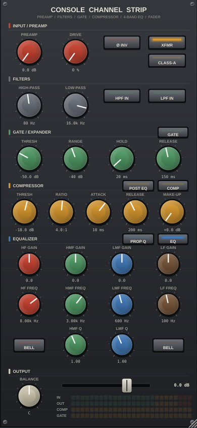

# Console Channel Strip (VST3)

A stereo channel strip in the spirit of a large-format console: preamp with saturation, filters, gate,
compressor, 4-band EQ and a fader. Original design and code, no third-party names or artwork.

## Signal path
`polarity -> preamp (0-72 dB) -> 4x-oversampled saturation (Transformer / Class-A) -> HPF / LPF -> gate -> compressor -> 4-band EQ -> (compressor, if POST EQ) -> fader -> balance`

* Left and right are never mixed. The gate and compressor use a linked detector (one gain for both sides).
* Constant latency of 48 samples at every sample rate, reported to the host.
* Use the preamp for quiet sources. With drive at 0 % the path is linear.

## Measured with `tests/strip_test.cpp` (48 kHz, 32-bit float)
| Spec | Result |
|---|---|
| Headroom | +24 dBFS sine passes with 0.0002 dB error, THD+N -134 dB |
| Preamp 60 dB / 72 dB | gain exact to 0.001 dB, THD+N below -132 dB |
| Noise floor | adds no noise: silence in gives exact silence out; a -120 dBFS tone is reproduced with residual far below float32 resolution |
| Crosstalk | left-only input with every stage engaged leaves the right output at exactly 0 |
| EQ | gains hit target within 0.1 dB at band centre; boost and cut are exact mirrors; shelves have no overshoot; PROP Q widens small boosts |
| Saturation | Transformer: odd harmonics, stronger at low frequencies. Class-A: second harmonic leads |
| Aliasing | 15 kHz at full drive: 3 kHz alias product -87 dB (non-oversampled: -17 dB) |
| Flatness | 40 Hz - 18 kHz within 0.001 dB |

Note: "headroom" and "noise floor" describe this plugin's own processing. A DAW running 32-bit float
has no practical clipping or hiss inside the plugin; the tests confirm the plugin adds none.
EQ filters are minimum-phase, so some phase shift is inherent to any analog-style EQ.

## Build (Windows, via GitHub Actions)
Push this repo to GitHub, open the Actions tab, open the latest run and download the
`ConsoleChannelStrip-VST3-win64` artifact. Unzip it and copy the `Console Channel Strip.vst3`
folder to `C:\Program Files\Common Files\VST3\`, then rescan plugins in your DAW.

## Run the tests (Linux/macOS, any C++17 compiler)
`g++ -O2 -std=c++17 -o strip_test tests/strip_test.cpp && ./strip_test`
